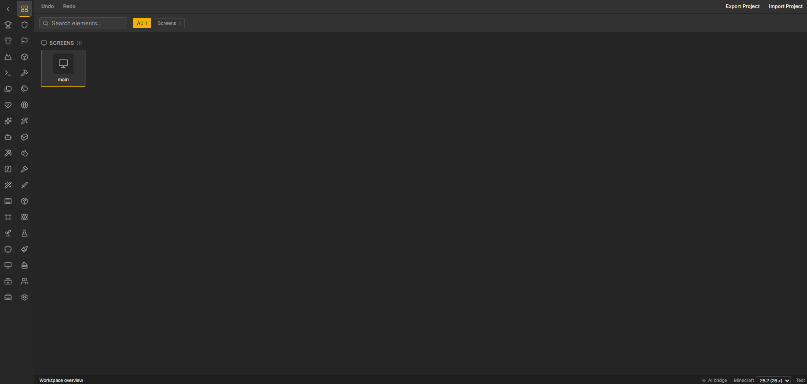
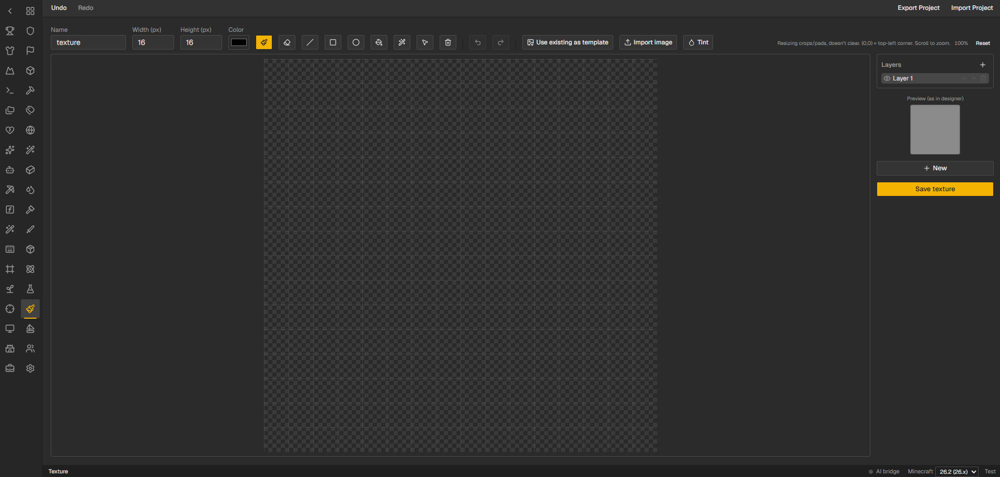
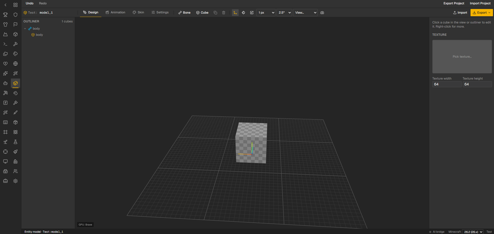

# Better Minecraft Mod Builder

A browser-based Minecraft mod workshop: a visual designer for GUI screens, items, blocks, entities and datapack content,
plus a NeoForge runtime library that loads its exported JSON. The layout and workflow follow
[MCreator](https://mcreator.net/). The 3D entity modeller follows [Blockbench](https://www.blockbench.net/).

Based on the original idea and code of [SheepFromHeaven/minecraft-mod-ui-builder](https://github.com/SheepFromHeaven/minecraft-mod-ui-builder): a screen designer plus a NeoForge runtime for `ScreenSpec` JSON. This fork extends it into a full mod builder.







- **[`webapp/`](webapp/)** — Next.js designer. Exports `ScreenSpec` JSON, mod assets, datapacks and Bedrock add-ons.
- **[`neoforge-runtime/`](neoforge-runtime/)** — NeoForge library that reads that JSON at runtime and builds real screens, items, blocks, entities and more, so you don't hand-code them.

Each subproject is released independently (see `release-please-config.json`) with its own version and changelog.

## Features

- **MCreator-style workspace**: a two-column icon rail for every element type, an "All categories" overview with search and filters, and a right-click menu (open, rename, duplicate, export, copy ID, delete).
- **Screen designer**: drag-and-drop widgets, container screens with inventory slots, and tabs at the top, left or right.
- **Element types** (MCreator-like): items, blocks, armor, tools, plants, fluids, effects, enchantments, damage types, banner patterns, paintings, functions, ore features, commands, game rules, key bindings, particles, projectiles, armor trims, village professions, structures, and more.
- **Mod elements** backed by runtime packages: commands, game rules, fluids, village professions, plants, particles, key bindings, special entities (boats), projectiles, armor trims and structures. Structures include an NBT structure viewer.
- **Resources tab**: upload images and organise them in folders.
- **Texture editor**: layers, pencil, line, shapes, fill, tint, and import from an image or an existing texture.
- **Entity Models** (Blockbench-lite):
  - **Design**: bones, cubes and a gizmo, with GPU rendering via three.js.
  - **Animation**: a keyframe timeline.
  - **Skin**: paint on the 3D model or the flat texture, and move UV areas so several faces can share one texture.
  - **Settings**: entity stats such as health, damage, damage type, AI goals and spawning.
- **Formats**: import and export `.bbmodel` (Blockbench), Bedrock `geo.json` and `animation.json`, **GeckoLib-compatible** geometry and animation JSON, Java entity model classes for 1.21.1 and 26.x, and a full Bedrock **`.mcaddon`**.
- **AI**:
  - An MCP server (`webapp/mcp/server.mjs`, in the style of [blockbench-mcp](https://github.com/sosadly/blockbench-mcp)) lets Claude, Codex or another MCP client build models, animations and textures live in the editor.
  - The **Entity Model Generator** tab runs Claude or Codex headless from the web UI. You type "build a slime mob…" and watch the model being built.
  - **Settings → AI** picks the provider: Claude, Codex or Ollama.
  - Local Stable Diffusion generates item, block and player skins (see `tools/skin-generator/`).
- **Minecraft versions**: 1.21.1 and 26.x.

## Quick start (designer)

```bash
cd webapp
npm install
npm run dev        # http://localhost:3000
npm run mcp        # optional: MCP server for AI clients (bridge on 127.0.0.1:8790)
```

## AI setup (optional)

The designer works without any AI. Each AI feature has its own setup below. They are all independent of each other.

### 1. Stable Diffusion textures and skins (Item Skin Generator)

The **Item Skin Generator** tab generates the following:

| What | Model | Download |
|---|---|---|
| 16×16 item textures | [yuuki14202028/minecraft-item-16px](https://huggingface.co/yuuki14202028/minecraft-item-16px) (SD 1.5) | ~2 GB, automatic |
| 16×16 block textures | [SD 1.5](https://huggingface.co/stable-diffusion-v1-5/stable-diffusion-v1-5) + [Minecraft Block Texture LoRA](https://civitai.com/models/55824) | ~2 GB + LoRA, automatic |
| 64×64 player skins | [monadical-labs/minecraft-skin-generator-sdxl](https://huggingface.co/monadical-labs/minecraft-skin-generator-sdxl) (SDXL) | ~7 GB, automatic |

The tab has two backends:

**a) Local GPU (recommended).** Requirements: Python 3.10+ and an NVIDIA GPU with CUDA (about 4 GB VRAM for items and about 12 GB for player skins). Apple Silicon (MPS) and CPU also work, but slowly.

```bash
cd tools/skin-generator
python3 -m venv .venv
# PyTorch with CUDA. Pick the index URL for your CUDA version on https://pytorch.org/get-started/locally/
.venv/bin/pip install torch --index-url https://download.pytorch.org/whl/cu128
.venv/bin/pip install -r requirements.txt
```

Linking it to the webapp:
1. Start the webapp with `cd webapp && npm run dev`.
2. In the sidebar, open **Item Skin Generator**, set the backend to **Local GPU** and click **Start**. The webapp launches `tools/skin-generator/.venv/bin/python server.py` itself. The log button shows the model download and loading.
3. On first use, the models download to `~/.cache/huggingface`. The block LoRA downloads from Civitai into `tools/skin-generator/models/`.

You can also start the server yourself. You must do this on Windows, where the venv is `.venv\Scripts\python.exe` and the app can't auto-start it:

```bash
cd tools/skin-generator
.venv/bin/python server.py          # serves http://127.0.0.1:7860 (also has a small test UI)
```

The webapp detects the running server and shows it as "started outside the app".

**b) Hugging Face Space (no GPU needed).** Pick **HF Space** in the tab. It uses the public [demo Space](https://huggingface.co/spaces/yuuki14202028/minecraft-item-16px-demo), which has a small anonymous quota. A token raises the quota.

Environment variables (put them in `webapp/.env.local`):

| Variable | Purpose | Default |
|---|---|---|
| `HF_TOKEN` | Hugging Face token for the Space backend | — |
| `SKIN_GENERATOR_SPACE_URL` | Your own duplicate of the Space | public demo |
| `SKIN_GENERATOR_LOCAL_URL` | URL of the local server (its port is passed to the server) | `http://127.0.0.1:7860` |
| `SKIN_GENERATOR_DIR` | Location of `tools/skin-generator` | `../tools/skin-generator` |
| `SKIN_GENERATOR_MODEL` | Item model, as a repo id or local path (set for `server.py`) | `yuuki14202028/minecraft-item-16px` |
| `SKIN_GENERATOR_BLOCK_LORA` | Path to the block LoRA `.safetensors` (set for `server.py`) | `tools/skin-generator/models/mc112blocksV1.1.safetensors` |

Licences: the models use CreativeML OpenRAIL-M. Using the block LoRA requires crediting it. Check generated textures for originality before you redistribute them.

### 2. AI agents for entity models (MCP)

An AI client (Claude Code, Codex, Claude Desktop and others) builds models, animations and textures live in the open editor tab.

1. Install a client, for example [Claude Code](https://claude.com/claude-code) (`npm i -g @anthropic-ai/claude-code`, then run `claude` once to log in) or [Codex CLI](https://github.com/openai/codex) (`npm i -g @openai/codex`, then `codex login`).
2. Register the MCP server, which is shipped in the webapp:
   ```bash
   claude mcp add mc-designer -- node /path/to/webapp/mcp/server.mjs
   ```
   For other clients, add `{"command": "node", "args": ["/path/to/webapp/mcp/server.mjs"]}` to their MCP config. Details are in [`webapp/mcp/README.md`](webapp/mcp/README.md).
3. In the editor, turn on **AI bridge** in the status bar (bottom right). The dot turns green once the MCP server is connected. The default bridge port is `127.0.0.1:8790`; change it with `MC_DESIGNER_MCP_PORT`.
4. Ask your client, for example "build a wolf-like hellhound with a walk animation".

Without a terminal: open the **Entity Model Generator** tab and type your prompt. The webapp starts `claude` or `codex` (whichever is installed and logged in, see Settings → AI) headless with this MCP server on its own free port, and streams the progress.

### 3. Local LLM (Ollama, optional)

Install [Ollama](https://ollama.com/download), run `ollama pull qwen3`, and select Ollama under **Settings → AI**. If Ollama doesn't run on `http://127.0.0.1:11434`, set `OLLAMA_HOST`.

## Using the runtime library in your NeoForge mod

Targets **NeoForge 26.2** (Minecraft 26.x, Java 21+). The designer exports for **1.21.1** and **26.x**; pick the version in the status bar.

### 1. Add the dependency

Grab the jar from the [GitHub Releases](https://github.com/SheepFromHeaven/minecraft-mod-ui-builder/releases) page and add it via a local or hosted Maven repo:

```gradle
repositories {
    mavenLocal() // or wherever you published the jar
}

dependencies {
    implementation "sheepfromheaven.screenspec:screenspec-neoforge:<version>"
}
```

### 2. Drop in the JSON

Put the file exported by the designer at:

```
src/main/resources/assets/<your_modid>/screenspec/<name>.json
```

### 3. Load and open the screen

```java
ScreenSpec spec = ScreenSpecLoader.fromResource(
    Minecraft.getInstance().getResourceManager(),
    "your_modid",       // your mod's namespace
    "settings_screen"); // filename without .json

SpecScreen screen = new SpecScreen(Component.literal("Settings"), spec);
screen
    .on("save_button",     (id, s, v) -> save())
    .on("volume_slider",   (id, s, v) -> setVolume((Double) v))
    .on("name_input",      (id, s, v) -> setName((String) v))
    .on("hardcore_toggle", (id, s, v) -> setHardcore((Boolean) v));
Minecraft.getInstance().setScreen(screen);
```

Widget ids are exactly what you named them in the designer.
A subclass / `onAction` override is also supported for class-per-screen style — see the [full docs](neoforge-runtime/README.md).

### Widget reference

| Designer widget  | Minecraft widget                  | Notes |
|------------------|-----------------------------------|-------|
| `button`         | `Button`                          | |
| `toggle_button`  | `Button` subclass with selection  | Widgets sharing the same non-empty `group` prop are mutually exclusive (radio group); empty group = independent on/off. |
| `input`          | `EditBox`                         | `max_length` / `hint_text` props applied. |
| `slider`         | `AbstractSliderButton` subclass   | `min` / `max` / `step` / `value` props; `text` is the display template (`%s` → current value). |
| `panel`          | Drawn directly (not a widget)     | Override `renderPanel` to use your mod's texture. |
| `label`          | Drawn directly                    | Honors `color`, `shadow`, `align` props. Override `renderLabel` to customize. |
| `icon`           | Drawn directly                    | Override `resolveIcon` to map an icon id to your mod's `ResourceLocation`. |

Need a custom widget type? Register your own factory:

```java
WidgetFactories.register("my_custom_type", (spec, screen) -> myWidget(spec));
```

## Releases & CI

[release-please](https://github.com/googleapis/release-please) tracks `webapp/` and `neoforge-runtime/` as separate packages. Merging conventional-commit PRs to `main` keeps a per-package release PR (with changelog) up to date; merging *that* PR tags a release (`webapp-vX.Y.Z` or `neoforge-runtime-vX.Y.Z`), which triggers:

- `neoforge-runtime-v*` tag → `.github/workflows/release-neoforge.yml` builds the Gradle project and attaches the jar (+ sources jar) to the GitHub release.
- `webapp-v*` tag → Vercel redeploys automatically on push to `main`.

## Built with / credits

Inspiration and file formats:
- [SheepFromHeaven/minecraft-mod-ui-builder](https://github.com/SheepFromHeaven/minecraft-mod-ui-builder) — the original project and basic idea (screen designer + NeoForge `ScreenSpec` runtime) this builds on.
- [MCreator](https://mcreator.net/) — the UI, layout and element categories are modelled on it.
- [Blockbench](https://www.blockbench.net/) — the entity editor workflow and the `.bbmodel` format.
- [blockbench-mcp](https://github.com/sosadly/blockbench-mcp) — the idea for the MCP-driven AI modelling.
- [GeckoLib](https://github.com/bernie-g/geckolib) — compatible geometry and animation `.json` export.
- [Minecraft Bedrock add-on format](https://learn.microsoft.com/minecraft/creator/) — `geo.json`, `animation.json`, behaviour and resource packs.
- [Faithful (Default-Java)](https://github.com/Faithful-Pack/Default-Java) — vanilla-style reference textures loaded from GitHub.
- [minotar/skin-spec](https://github.com/minotar/skin-spec) — the player skin layout.

AI models and tools:
- [Claude Code](https://claude.com/claude-code) (Anthropic) and [Codex CLI](https://github.com/openai/codex) (OpenAI) — agent backends that drive the MCP server.
- [Ollama](https://ollama.com/) (for example `qwen3`) — optional local LLM backend.
- [yuuki14202028/minecraft-item-16px](https://huggingface.co/yuuki14202028/minecraft-item-16px) — a Stable Diffusion 1.5 fine-tune for 16×16 item textures.
- [monadical-labs/minecraft-skin-generator-sdxl](https://huggingface.co/monadical-labs/minecraft-skin-generator-sdxl) — an SDXL model for player skins.
- [stable-diffusion-v1-5](https://huggingface.co/stable-diffusion-v1-5/stable-diffusion-v1-5) plus the [Minecraft Block Texture 1.12 LoRA](https://civitai.com/models/55824) — block textures.
- [diffusers](https://github.com/huggingface/diffusers), [transformers](https://github.com/huggingface/transformers), [PyTorch](https://pytorch.org/), [Gradio](https://github.com/gradio-app/gradio) — the local skin-generator backend.

Libraries:
- [Next.js](https://github.com/vercel/next.js), [React](https://github.com/facebook/react), [Tailwind CSS](https://github.com/tailwindlabs/tailwindcss), [shadcn/ui](https://github.com/shadcn-ui/ui) and [Base UI](https://github.com/mui/base-ui), [lucide](https://github.com/lucide-icons/lucide) icons.
- [three.js](https://github.com/mrdoob/three.js) — 3D viewport (WebGL, GPU-accelerated).
- [Model Context Protocol TypeScript SDK](https://github.com/modelcontextprotocol/typescript-sdk) and [zod](https://github.com/colinhacks/zod) — the MCP server.
- [dnd-kit](https://github.com/clauderic/dnd-kit), [react-rnd](https://github.com/bokuweb/react-rnd), [JSZip](https://github.com/Stuk/jszip), [sonner](https://github.com/emilkowalski/sonner).
- [Vitest](https://github.com/vitest-dev/vitest) and [Playwright](https://github.com/microsoft/playwright) — tests.
- [NeoForge](https://neoforged.net/) — the mod loader for the runtime library.

Minecraft is a trademark of Mojang Studios. This project is not affiliated with Mojang, Microsoft, MCreator or Blockbench.

